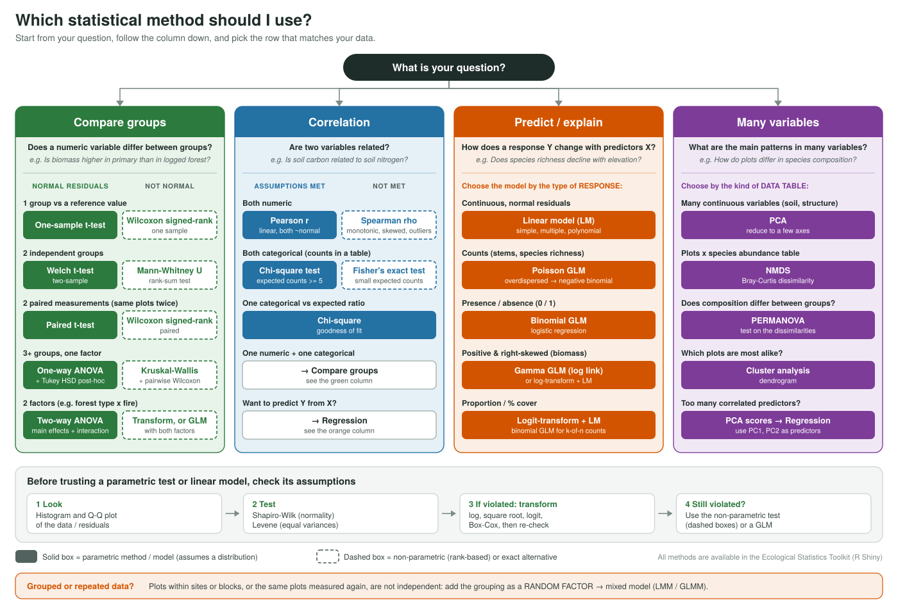

# Ecological Statistics Toolkit — R Shiny App

An interactive web application for ecological data analysis, built with R Shiny.
It started as the *Trend Analysis Tool* (regression, correlation, GLM) and now
covers the whole route from "which test do I need?" to multivariate analysis:
upload your own data, explore it, check and fix normality, compare groups,
measure correlation, fit regression models (with optional random factors), and run PCA / NMDS — step by step,
with a plain-language interpretation of every result.



## Features

| Tab | What it does |
|-----|-------------|
| **Guide** | Decision chart and a short questionnaire that recommends a method, with R code and an ecological example |
| **1. Data** | Load `.xlsx`, `.xls`, or `.csv` files, or one of two example forest datasets |
| **2. Explore** | Histograms, density, boxplots (optionally by group), scatter plots, correlation heatmap |
| **3. Transform** | Shapiro-Wilk + Q-Q plot before/after; log, ln(x+1), square root, cube root, reciprocal, square, arcsine-sqrt, logit, Box-Cox, Yeo-Johnson, rank-based inverse normal; ranking of all transformations; add the transformed column to the data |
| **4. Compare groups** | One-sample, two-sample (Welch/Student) and paired t-tests; one-way, Welch and two-way ANOVA with Tukey post-hoc; Wilcoxon, Mann-Whitney, Kruskal-Wallis; assumption checks and effect sizes |
| **5. Correlation** | Pearson vs Spearman vs Kendall side by side; correlation matrix with significance; chi-square tests of independence and goodness of fit, Fisher's exact test, Cramér's V |
| **6. Regression** | The original workflow as four sub-tabs — **Model setup**, **Results**, **Diagnostics**, **Visualise** — for simple, multiple and polynomial linear models and GLMs (Gaussian, Poisson, negative binomial, binomial, Gamma, inverse Gaussian), now with optional **random factors** (mixed models: LMM / GLMM), dispersion check, Type II tests and VIF |
| **7. Multivariate** | PCA (biplot, scree, loadings, export scores); NMDS with PERMANOVA and dispersion test; hierarchical cluster analysis |

Every analysis shows the R output, a sentence "in words", and a warning with a
suggested alternative when an assumption is violated.

### Supported model types

- **Simple linear regression** (`lm`)
- **Multiple linear regression** (`lm` with multiple predictors)
- **Polynomial regression** (quadratic, cubic, up to degree 5)
- **GLM** — Gaussian, Poisson, Negative binomial, Binomial, Gamma, Inverse Gaussian families
- **Mixed models** — any of the above with one or more random factors
  (random intercepts): `lmer` for linear models, `glmer` / `glmer.nb` for GLMs

---

## Quick start (run locally)

### Prerequisites

Install R (≥ 4.1) and RStudio. Then install the required packages:

```r
install.packages(c(
  "shiny", "bslib", "readxl", "tidyverse", "car",
  "DT", "plotly", "broom", "MASS", "lme4", "lmerTest", "vegan"
))
```

`lme4` is only needed when you choose a random factor (`lmerTest` adds
p-values for linear mixed models), and `vegan` only for NMDS / PERMANOVA /
Bray-Curtis clustering; the rest of the app works without them.

### Run

```r
# In RStudio: open app.R and click "Run App"
# OR from the R console:
shiny::runApp("path/to/regression")
```

Then go to **1. Data** and click **Load example data** to try everything
without your own file.

### Online

Access through https://hasna-afifah.shinyapps.io/trend-analysis-tool/ 

## Repository layout

```
app.R                      UI layout + server wiring
R/helpers.R                theme, transformations, small statistical helpers
R/mod_guide.R              Guide tab (chart + method chooser)
R/mod_data_explore.R       Data and Explore tabs
R/mod_transform.R          Transform tab
R/mod_groups.R             Compare groups tab
R/mod_association.R        Correlation tab (correlation + chi-square)
R/mod_regression.R         Regression tab (LM, GLM, mixed models)
R/mod_multivariate.R       Multivariate tab
DEPLOY.md                  step-by-step guide to publishing on shinyapps.io
.rscignore                 files left out of the shinyapps.io upload
data/                      example datasets (simulated)
data-raw/make_example_data.R   script that generates the example data
www/method_decision_chart.svg|png   "when to use which method" chart
module/                    teaching module (R Markdown + rendered HTML)
```

Files in `R/` are sourced automatically by Shiny (≥ 1.5).

## Teaching module

`module/ecological_statistics_module.html` is a self-contained course module
("Statistics for Forest Ecologists") that walks through every method with
forest-ecology examples, R code, interpretation, the matching steps in the app,
and exercises with answers. Rebuild it after editing the `.Rmd`:

```r
rmarkdown::render("module/ecological_statistics_module.Rmd")
```

## Example data

Both datasets are **simulated** so that each method has a known pattern to
find — they are for teaching, not real field results.

- `data/forest_plots.csv` — 120 plots in four forest types (Primary, Logged,
  Agroforest, Plantation) with topography, soil, stand structure, biomass,
  species richness, seedling counts, hornbill presence, fire history, paired
  dry/wet season soil moisture, and a `site` grouping (12 sites) with canopy
  height for the random-factor examples.
- `data/tree_community.csv` — stem counts of 14 tree taxa in 40 plots, for
  NMDS, PERMANOVA and clustering.

Regenerate them with `Rscript data-raw/make_example_data.R`.

## Which method when — in short

| Question | Data | Method | Not normal / alternative |
|---|---|---|---|
| One group vs a reference value | numeric | one-sample t-test | Wilcoxon signed-rank |
| Two independent groups | numeric + 2 groups | Welch t-test | Mann-Whitney U |
| Two paired measurements | numeric, same units twice | paired t-test | Wilcoxon signed-rank |
| Three or more groups | numeric + factor | one-way ANOVA + Tukey | Kruskal-Wallis |
| Two factors | numeric + 2 factors | two-way ANOVA | transform, or GLM |
| Two numeric variables related? | numeric + numeric | Pearson r | Spearman rho |
| Two categorical variables related? | counts | chi-square | Fisher's exact |
| Predict a continuous response | numeric Y | linear model | transform Y, or Gamma GLM |
| Predict a count | count Y | Poisson GLM | negative binomial |
| Predict presence/absence | 0/1 Y | binomial GLM | — |
| Any regression with grouped / repeated data | plots within sites, re-measured plots | mixed model (random factor) | — |
| Summarise many continuous variables | numeric table | PCA | — |
| Compare species composition | plots × species | NMDS + PERMANOVA | — |
| Find groups of similar plots | numeric / species table | cluster analysis | — |

## How it works — a walkthrough

### 0. Not sure which test to use? (Guide)

Answer two or three questions in the **Method chooser** or study the decision
chart — the app recommends a method, tells you where to find it, and shows the
R code and an ecological example.

### 1. Upload your data (Data)

Accepted formats: Excel (`.xlsx`, `.xls`) or CSV. Each column = one variable.
The app auto-detects sheet names for Excel files. You can also click
**Load example data** to try everything with a simulated forest dataset.

### 2. Explore your data (Explore)

- Check distributions of individual variables (histogram, density, boxplot),
  optionally split by a grouping variable.
- Look at bivariate scatter plots with a LOESS smoother.
- Inspect the correlation matrix to spot collinearity before modelling.

### 3. Check and fix normality (Transform)

- Run a Shapiro-Wilk test and Q-Q plot on any numeric column.
- Try 10+ transformations (log, ln(x + 1), square root, cube root, reciprocal,
  square, arcsine-sqrt, logit, Box-Cox, Yeo-Johnson, rank-based inverse normal)
  — the app ranks them all and lets you add the best one to your data.
- See the before/after Q-Q plot side by side.

### 4. Compare groups (Compare groups)

- **One-sample**, **two-sample** (Welch / Student) and **paired t-tests**.
- **One-way ANOVA** + Tukey HSD, **Welch's ANOVA**, and **two-way ANOVA**.
- Non-parametric alternatives: **Wilcoxon signed-rank**, **Mann-Whitney U**,
  **Kruskal-Wallis** with pairwise comparisons.
- Automatic assumption checks (normality, equal variances) and **effect sizes**
  (Cohen's d, eta-squared).

### 5. Measure correlation (Correlation)

- **Pearson**, **Spearman**, and **Kendall** correlation side by side, with
  significance and confidence intervals.
- Full correlation matrix with significance stars.
- **Chi-square** tests of independence and goodness of fit, **Fisher's exact
  test**, and **Cramér's V** for categorical variables.

### 6. Fit a regression model (Regression)

Four sub-tabs walk you through the modelling workflow:

| Sub-tab | What you do |
|---------|-------------|
| **Model setup** | Pick response (Y) and predictor(s) (X); choose Linear, Polynomial, or GLM (Gaussian, Poisson, Negative binomial, Binomial, Gamma, Inverse Gaussian); optionally **scale** predictors, include **interactions**, or add **random factors** (site, block, year → mixed model). |
| **Results** | Coefficient table (estimates, SE, t/z, p, CI); fit statistics (R², adj. R², F-test, AIC, deviance, marginal/conditional R²); **VIF** for collinearity; variance components and ICC for mixed models. |
| **Diagnostics** | Q-Q plot, Shapiro-Wilk test, Residuals vs Fitted, Scale-Location. Warnings appear when an assumption is violated. |
| **Visualise** | Regression line with confidence bands (80%–99%); download as PNG. |

### 7. Multivariate analysis (Multivariate)

- **PCA**: biplot, scree plot, loadings table; export PC scores to your data.
- **NMDS** (Bray-Curtis): ordination plot with group ellipses; **PERMANOVA**
  and betadisper test for compositional differences.
- **Hierarchical cluster analysis**: dendrogram with group labels; Euclidean or
  Bray-Curtis distance.

---

## Tips

- **Start with the Guide** if you are not sure which analysis to use.
- Explore data types and distributions first — it tells you which method is
  appropriate.
- **Normality matters for the residuals** (or the values within each group),
  not for the pooled raw variable.
- If data are not normally distributed, try a transformation (Transform tab)
  before fitting a linear model, or use a GLM for counts and presence/absence.
- For **logistic regression**: make sure your response is 0/1, choose
  GLM → Binomial.
- For **Poisson regression** (count data): choose GLM → Poisson; switch to
  Negative binomial if the dispersion statistic is well above 1.
- For **Gaussian response curves** (e.g. species abundance vs pH): use
  Polynomial Regression with degree 2.
- **Scale predictors** when variables are measured on different units.
- For **grouped or repeated data** (plots within sites, re-measured plots): add
  the grouping variable as a **random factor** instead of ignoring it.
- Report **effect sizes** (difference in means, r, R², Cohen's d) alongside
  every p-value.
- Always **check diagnostic plots** before trusting your results.

---

## Credits

Tool developer: **Hasna Afifah** with Claude assistance

**Inspired by the Ecological Methods course (WEC – Wageningen University & Research).**

To Fred de Boer, Frank van Langevelde, Henjo de Knegt, and all the other EM1 teachers: thank you for the amazing course and inspiring this work❤️
Powered by R, Shiny, ggplot2, plotly, bslib, car, MASS, vegan.
